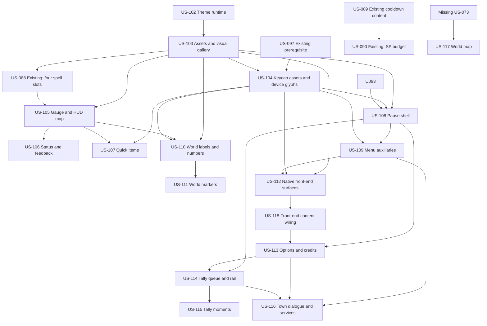

# Tin Tally in-engine implementation plan

Status: implementation specification for review. This document creates no engine code or assets.

## Goal and scope

Build the final Tin Tally presentation in Unreal Engine 5.7 without replacing working gameplay. The implementation keeps the native C++ fallback pattern, preserves every required `BindWidgetOptional` name, uses CommonUI layers and input routing, and makes the two design-system themes visually testable in packaged Development builds.

The plan covers all seven owner tracks:

1. Foundation: theme data, typography, primitives, pattern material, glyphs, `UMordecaiTallyWidget`, device keycaps, and visual acceptance.
2. HUD restyle: the complete HUD map, existing readouts, four spell slots, status/callout fixes, interaction/loadout, quick items, and low-health treatment.
3. Menus: pause shell and tabs, death, dialogs, cards, and status tooltip.
4. World-space: enemy tags, pooled damage numbers, pickup labels, and world markers.
5. Front end: a Mordecai title-to-expedition flow, loading screen, options, and credits in place of Lyra presentation.
6. Tally system: queue, rail, plate, receipt pacing, banners, and boss bar.
7. Town and world map: dialogue, Mage Tower/service screens, and world map, held as decision-blocked stubs.

Out of scope for this specification: implementation code, `.uasset` or other binary assets, level art, audio production, filing issues, and changing decisions D1-D27. Gameplay systems are changed only when a listed UI story explicitly absorbs an existing recovery issue.

## Sources and precedence

`Design/TinTally/ds/BUILD.md` D1-D27 wins on disagreement. The engine manifest and names come from `Design/TinTally/ds/project/03-building-in-unreal.md`; placement and pacing come from `02-hud-and-pacing.md`; unresolved choices come from `04-open-decisions.md`; component anatomy comes from each `Design/TinTally/ds/project/components/*/README.md`; values come from `tokens.json`. Current code, story, issue, and playtest facts below were rechecked on `main` at `0a710eff3178e886d73ad30ec5f5b226c150fc55`.

## Current state on main

### Architecture already in place

- `Source/LyraGame/Mordecai/UI/MordecaiCombatHUDWidget.h` already derives from `ULyraActivatableWidget`. `AMordecaiPlayerController::CreateCombatHUD()` in `Source/LyraGame/Mordecai/MordecaiPlayerController.cpp` pushes it once on `UI.Layer.Game`.
- The death screen remains the only later push on `UI.Layer.Game` (`MordecaiDeathScreenComponent.cpp`), and pause uses `UI.Layer.Menu` (`MordecaiPauseMenuSubsystem.cpp`).
- `UMordecaiEquippedWeaponWidget` is already a child of the HUD at bottom-right `(-32,-32)`, `340x84`; it is not independently added to the viewport.
- The HUD fallback still places most other widgets in prototype boxes in `MordecaiCombatHUDWidget.cpp`: 20 px bar margins, two `120x16` cooldowns, status at bottom-left, and feedback/combo at bottom-centre. The final map exists only in the design documents.
- `UIndicatorLayer` is already a full-screen HUD child at Z order -1.

### Existing functional surfaces

- Resource and spell UI: `UMordecaiHealthBarWidget`, `UMordecaiStaminaBarWidget`, `UMordecaiPostureBarWidget`, `UMordecaiSpellPointsBarWidget`, `UMordecaiSpellCooldownWidget`, and `UMordecaiStatusEffectBarWidget`.
- Feedback and interaction: `UMordecaiCombatFeedbackWidget`, `UMordecaiComboCounterWidget`, `UMordecaiKillCounterWidget`, `UMordecaiPickupPromptWidget`, and `UMordecaiEquippedWeaponWidget`.
- Menus/screens: `UMordecaiPauseMenuWidget`, `UMordecaiTabButton`, `UMordecaiCharacterSheetWidget`, `UMordecaiInventoryWidget`, `UMordecaiSkillTreeWidget`, `UMordecaiFeatDisplayWidget`, `UMordecaiDeathScreenWidget`, and `UMordecaiLoadingScreenWidget`.
- World UI: `UMordecaiEnemyIndicatorWidget`/`Component` and `UMordecaiDamagePopComponent`.
- Empty WBP shells under `Plugins/GameFeatures/MordecaiCore/Content/UI/` exist for the combat HUD, four bars, A/B cooldowns, status bar/indicator, feedback, combo, and kill counter. There are no C/D cooldown WBP assets or final Tin Tally theme/font/material assets.

### Cooldown state after issue #35 / PR #97

- Native tags `Mordecai.Cooldown.Spell.*` exist in `MordecaiGameplayTags.cpp`.
- `DA_Spell_Fireball`, `Blink`, `StoneSkin`, and `Restoration` were changed by merged PR #97, and A/B are bound by `BindSpellCooldownSlots`.
- The HUD class and fallback still expose only `SpellCooldownA` and `SpellCooldownB`. Issue #13 and unchecked AC-088.3 still own C/D plus Q/E/R/1 slot labels. Do not duplicate US-088.

### Gaps

- No `UMordecaiUIThemeDataAsset`, `UMordecaiTallyWidget`, `UMordecaiTallySubsystem`, theme assets, composite fonts, CommonUI text styles, `M_UI_PatternFill`, or `T_UI_Hatch16`.
- No native Tin Tally `QuickItems`, `BossBar`, `Banner`, `TallyRail`, `TallyPlate`, `ReceiptTimeline`, `PickupLabel`, `WorldMarkers`, title, expedition, credits, options, dialogue, Mage Tower, service, or world-map classes.
- Front-end map/config remains Lyra-hosted (`L_LyraFrontEnd`, `B_LyraFrontEnd_Experience`). The loading overlay is already native Mordecai via `Config/DefaultGame.ini`, but its visual style is not Tin Tally.
- Existing shipped text is asserted by `Scripts/playtests/us057_magic.py`, `us069_pause_menu.py`, `us079_inventory.py`, `us054_combat.py`, `us091_death_layering.py`, and `us091_weapon_hud.py`. In particular, preserve `"You Died"`, `"Kills: N"`, `"Coming Soon"`, `"Stored Resources"`, `"[F] Pick up …"`, and `"[I] Inventory"`. The current status widget renders `"Status"` (issue #21); `"StoneSkin"` is the failing Tier 4 expectation that must change to `"Stone Skin"` with the fix.

## Cross-cutting implementation rules

- Convert every hex from `tokens.json` with `FLinearColor::FromSRGBColor(FColor::FromHex(...))`; never paste sRGB numbers directly into `FLinearColor`.
- Build `DA_UITheme_Diorama` and `DA_UITheme_HighContrast`; all component tints, existing designer-overridable colours, rarity colours, focus, and world-marker colours come from the active asset.
- Use RoundedBox overlays for plate, pill, tag, well, keycap, and focus primitives. Do not create plate textures or use retired names from `03`.
- Import static TTFs, not the preview WOFF2 variable fonts. Create `F_Tally_Display`, `F_Tally_UI`, `F_Tally_Mono`, and one `TS_Tally_<style>` for every `tokens.json` type style at `px * 0.75` points.
- `M_UI_PatternFill` samples `T_UI_Hatch16` in screen pixels and is shared by stamina, debt, broken posture, drawback, and cooldown shutter.
- Glyphs are single-ink masks; tally imagery is limited to ranks, rarity, seal, and throbber. `UMordecaiTallyWidget` owns `Count` and `Max`.
- All WBP replacements retain the manifest's names and types. New optional names get working C++ fallbacks.
- Keycaps do not replace `"[F] Pick up …"` or `"[I] Inventory"` until the same story changes the corresponding Tier 4 assertions. Capitalization uses `TextTransformPolicy`, never modified source strings.
- Every implementation story starts with red Tier 1 tests, then compiles and runs all automation, Tier 2 PIE, commits, packages that exact commit, runs Tier 3 and Tier 4 on the same Development package, opens every screenshot, and proves no baseline PASS became FAIL.
- The single Windows laptop is a serial resource. Implement in the order below; do not package two stories concurrently.

## Visual-acceptance contract

The foundation pair builds a deterministic harness, used by every later story:

1. `Design/TinTally/tools/render.py render <Component> --themes diorama,high-contrast` produces the canonical HTML preview images at their declared design size.
2. A packaged Development-only visual gallery reaches every implemented component with deterministic fixture data at 1920x1080, UI scale 100%, fixed camera/exposure, no temporal motion, and one theme at a time. It uses the real runtime widget classes and cooked assets, not editor preview widgets.
3. The packaged capture writes one full-frame PNG and one named component crop per component/theme/state. The manifest records source component, preview file, theme, state, crop rect, commit, and package build.
4. Comparison normalizes only the documented browser-versus-Slate font rasterization fringe. Geometry, color, content, visibility, and focus-state differences are not masked. The automated report includes pixel-diff heatmap and structural-similarity metrics; acceptance also requires a human to open the side-by-side and confirm anatomy, type hierarchy, hard edges, map box, and exact text.
5. Each story lists its required shots. Both Diorama and High Contrast must pass before the story closes. A missing, stale, black, unread, or wrong-theme image is a failure.
6. Tier 3/Tier 4 screenshots remain gameplay evidence; visual-gallery comparison is additional evidence, never a substitute.

## Ordered story list

The list has 20 implementation stories: 17 new repo stories and three existing recovery stories referenced rather than duplicated. US-097 is an additional referenced prerequisite for US-104, not a Tin Tally surface story.

Here, **Ready** means the story is scoped and its listed prerequisites are sufficient; it does not override repository scheduling. `stories/PLANNER.md` still makes Epic R the current selectable priority. Because the single Windows worker can run only one build/playtest at a time, execute at most one story from this sequence at once and use the graph for true prerequisites rather than interpreting the sequence as extra technical dependencies.

| Seq | Story | Track | Status | Depends on | Size |
|---:|---|---:|---|---|---|
| 1 | US-102 Theme runtime and Tin Tally primitives | 1 | Ready | none | L |
| 2 | US-103 Foundation assets and visual-acceptance gallery | 1 | Ready | US-102 | XL |
| 3 | US-104 Device-aware keycap assets and glyph prompts | 1 | Blocked | US-103, US-097; device-glyph decisions | M |
| 4 | US-088 Four spell-slot HUD completion | 2 | Existing backlog, partially complete | US-103 | M |
| 5 | US-090 Spell-point budget | 2 | Existing blocked story | US-089; SP decision | M |
| 6 | US-105 Gauge, HUD map, prompt, loadout, low-health frame | 2 | Ready | US-103, US-088 | XL |
| 7 | US-106 Status chips, combat callouts, and combo | 2 | Partially blocked | US-105; callout-size decision | L |
| 8 | US-107 Quick-items surface | 2 | Blocked | US-104, US-105; cap/key decisions | M |
| 9 | US-093 Pause tab contents | 3 | Existing backlog | none | L |
| 10 | US-108 Pause shell and tab restyle | 3 | Ready after keycap policy | US-103, US-104, US-093 | XL |
| 11 | US-109 Death, dialog, item/spell cards, status tooltip | 3 | Partially blocked | US-104, US-108; Identify/Use/Equip decisions | L |
| 12 | US-110 Enemy tags, pooled damage numbers, pickup labels | 4 | Ready after keycap policy | US-103, US-104, US-105 | XL |
| 13 | US-111 World markers | 4 | Blocked | US-103, US-110; UI/VFX and targeting decisions | L |
| 14 | US-112 Native title, expedition select, and loading surfaces | 5 | Ready after keycap policy | US-103, US-104, US-109 | L |
| 15 | US-118 Front-end content wiring and backdrop | 5 | Ready | US-112 | L |
| 16 | US-113 Options and credits | 5 | Blocked | US-108, US-118; settings/save/localization decisions | L |
| 17 | US-114 Tally queue, rail, receipt, and pause spike | 6 | Blocked | US-108, US-113; Tally/rank/settings/remark decisions | XL |
| 18 | US-115 Tally plates, banner, and boss bar | 6 | Blocked | US-114; gameplay data decisions | L |
| 19 | US-116 Dialogue, Mage Tower, and service screens | 7 | Blocked | US-109, US-113, US-114; town/Identify/vendor decisions | XL |
| 20 | US-117 World map | 7 | Blocked | missing US-073; map-form and world-data decisions | L |

The graph is the actual dependency DAG. The sequence table is the preferred order for the one Windows worker: continue to the next item whose declared dependencies are satisfied, never run two package/playtest jobs concurrently, and never let a later story silently assume a skipped blocked story.

## Story specifications and draft issues

### US-102 — Theme runtime and Tin Tally primitives

- **Surfaces/components:** both themes; Plate, Tag, Keycap geometry, Tally, Glyphs, Button primitives.
- **Touches:** new `UMordecaiUIThemeDataAsset`, runtime theme resolver/settings hook, `UMordecaiTallyWidget`; shared RoundedBox builders and CommonUI style bases. No content assets in this HEADLESS half.
- **Names:** `Count`, `Max`; theme fields for every color token; preserve all existing widget names.
- **Acceptance:** exact sRGB conversion tests for representative opaque/alpha tokens; Diorama default and live High Contrast swap invalidate/repaint existing widgets; all primitives expose D1-D27 states without texture-only text; tally clamps 0..Max and supports frames 0..5.
- **Tests/playtest:** `Mordecai.UI.Theme.*`, `Mordecai.UI.TallyWidget.*`; PIE verifies one active theme service; packaged boot remains unchanged and Tier 4 sweep has no regression.
- **Visual shots:** none accepted until US-103 supplies cooked assets; US-102 records `NOT YET PLAYABLE — pending US-103`.
- **Issues:** establishes the style answer for #62; does not close it alone.
- **Issue title:** `Tin Tally: add theme runtime and shared UI primitives`
- **Issue body:** Add the native Tin Tally theme contract, sRGB-safe token conversion, reusable RoundedBox primitives, and `UMordecaiTallyWidget` while preserving current C++ fallback widgets and bindings. This is the code half of the foundation; it becomes player-visible only with US-103's cooked fonts, materials, glyphs, theme assets, and packaged visual-gallery evidence.

### US-103 — Foundation assets and visual-acceptance gallery

- **Surfaces/components:** Foundation Cover/Glyphs/Keycap/Plate/Tag/Tally and the gallery shell for all 44 component cards.
- **Touches/assets:** `DA_UITheme_Diorama`, `DA_UITheme_HighContrast`; static Rowdies/Atkinson TTF imports; `F_Tally_Display/UI/Mono`; every `TS_Tally_*`; RoundedBox style assets; focus brush; `M_UI_PatternFill`; `T_UI_Hatch16`; 117 glyph masks; tally atlas and badge silhouettes; cooked gallery map/widget plus capture/compare scripts.
- **Acceptance:** every asset is saved/committed/cooked; fonts have OFL notices for later Credits; material tiles in screen pixels; focus is ink|focus|ink in both themes; gallery can capture and compare any named component/state from a clean package and rejects stale/missing/wrong-theme images.
- **Tests/playtest:** asset-reference and cook tests; PIE asset-load smoke; Tier 3 packaged gallery smoke; `render.py check`; one Foundation component comparison in both themes as proof; no PASS-to-FAIL sweep.
- **Visual shots:** Plate, Tag, Keycap, Tally and Glyphs in both themes against their preview renders.
- **Issues:** supplies the implementation basis for #62.
- **Issue title:** `Tin Tally: import foundation assets and packaged visual-acceptance gallery`
- **Issue body:** Create the two theme assets, static font/composite/style assets, rounded primitives, focus brush, hatch material/texture, glyph/tally/badge assets, and a deterministic packaged-build gallery that compares runtime component captures with both Tin Tally preview themes. Require committed cooked content, side-by-side review, and the normal packaged/Tier 4 regression ladder.

### US-097 — Existing recovery story: valid gamepad keys

Use `stories/backlog/US-097-recovery-gamepad-key-names.md`; do not duplicate it. It fixes invalid stick/L3 names only. Its open spell-button decision is not silently resolved by Tin Tally. Surface: runtime input used by keycaps; classes: `MordecaiHeroComponent`; acceptance/tests/shots are the existing story's valid-key tests, MovementTestMap gamepad Tier 4 checks, and movement screenshots; issues: #33.

- **Issue title:** `Recovery: fix invalid gamepad movement, aim, and sprint keys`
- **Issue body:** Replace invalid runtime FKey names for the left/right sticks and L3, add a validation test for every runtime mapping, and prove movement and sprint with real gamepad input in a packaged build. Keep the separate spell-button model decision open and do not change spell mappings in this issue.

### US-104 — Device-aware keycaps and glyph prompts (blocked stub)

- **Blockers:** device-aware glyph policy; CommonUI action-widget integration choice; pad symbol/letter policy; direct-spell versus Skill A/B model; gamepad Inventory hint.
- **Surfaces/components:** Keycap and every prompt/hint bar.
- **Touches:** CommonInput controller data for KBM/Xbox/PlayStation and `UCommonActionWidget`/`UCommonBoundActionBar` styling; later coordinated edits to `MordecaiPickupPromptWidget` and relevant playtests. If the approved policy needs native code, split a paired HEADLESS story first.
- **Acceptance after decisions:** one active device family per screen, correct unavailable dashed caps and focus states. Before keycaps, strings remain `"[F] Pick up {item}"` and `"[I] Inventory"`; after keycaps, real labels are `"Pick up {item}"` and `"Inventory"`, with Tier 4 constants updated in the same commit.
- **Tests/playtest:** controller-data asset tests; PIE input-type switching; packaged Keycap/InteractPrompt comparison in both themes for KBM/Xbox/PlayStation; real-input US-079/pause/front-end checks and full sweep.
- **Shots:** Keycap state sheet and prompt/hint samples, both themes and three device families.
- **Issues:** depends on #33/US-097 but does not duplicate its valid-key fix.
- **Issue title:** `Tin Tally: add device-aware CommonUI keycaps`
- **Issue body:** After Jeff chooses the prompt and controller-glyph policies, add Tin Tally keycaps through CommonInput for keyboard/mouse, Xbox, and PlayStation, wire CommonUI action widgets and hint bars, and update shipped-string playtests in the same story that removes bracketed key text. Until those decisions are made, this remains a stub and no unbound control is drawn as bound.

### US-088 — Existing recovery story: complete four spell slots

Use `stories/backlog/US-088-recovery-spell-cooldowns-hud.md`. PR #97 completed tags, spell DataAssets, cooldown logic, and A/B binding; unchecked AC-088.3 and issue #13 remain. Extend that story, rather than creating another four-slot story, to add `SpellCooldownC/D`, bind slots 2/3, and style all four as `78x78` SpellSlot shutters with Q/E/R/1 labels. Surfaces/classes/names: SpellSlot, `UMordecaiCombatHUDWidget`, `UMordecaiSpellCooldownWidget`, `SpellCooldownA-D`, `CooldownProgressBar`, `CooldownText`; acceptance/tests/shots are AC-088.3, four-slot automation/PIE/Tier 4, and ready/cooling/locked/unaffordable captures in both themes; issues: #13.

- **Issue title:** `Tin Tally: complete four direct spell slots on the HUD`
- **Issue body:** Finish US-088's remaining AC by adding and binding SpellCooldownC/D, placing all four Q/E/R/1 slots in the final HUD boxes, and applying the Tin Tally well/shutter/cost/keycap states. Reuse the cooldown tags and DataAssets delivered by PR #97 and prove all four slots in the packaged magic playtest and both themes.

### US-090 — Existing recovery story: spell-point budget

Use `stories/backlog/US-090-recovery-spell-point-budget.md`. It remains blocked by Jeff's SP rule. Tin Tally's gauge can render 10-16 tokens and the manifest's above-16 bar fallback, but it must not decide the gameplay budget. Surface/class: GaugePlate SP readout and GAS spell-point attributes; acceptance/tests/shots remain the existing all-spells-castable/optional-respawn checks and post-cast gauge capture; issue: #11.

- **Issue title:** `Recovery: decide and fix the spell-point budget`
- **Issue body:** After Jeff chooses max SP, regeneration, respawn restoration, costs, or a combination, implement that rule in GAS and update the real-input magic plan so all four loadout spells can be cast as intended. Keep the Tin Tally token-versus-bar display rule separate from the gameplay decision.

### US-105 — Gauge, HUD map, interaction/loadout, and low-health frame

- **Surfaces/components:** GaugePlate, Bar, HUDLayout, InteractPrompt, LoadoutPlate, LowHealthFrame; integrates US-088 SpellSlots and existing status/feedback slots at final map boxes.
- **Touches:** `UMordecaiCombatHUDWidget`; health/stamina/posture/SP widgets; pickup prompt and equipped weapon widget; new gauge wrapper and optional names `GaugePlate`, `HealthPercentText`, `HealthTrailBar`, `HealthLeadBar`, `StaminaTierText`, `StaminaDebtBar`, `SpellPointTokens`, `LowHealthFrame`.
- **Names:** preserve `IndicatorLayer`, `EquippedWeaponWidget`, `WeaponNameText`, `WeaponIcon`, `DamageSubtypeText`, `ElementIcon`, and `SwapKey` as well as every manifest name; all optional names require native fallbacks.
- **Acceptance:** exact 1920x1080 anchors/sizes; exact 32 and 96 margin modes, including the HUDLayout card's 784 px top-centre width at 96; health percent/trail/lead; stamina tiers/debt; posture hidden at max and fixture-only broken look; 10-16 SP tokens plus above-16 fallback; prompt/hint and loadout retain exact strings; low-health threshold at 25%; one HUD push only.
- **Tests/playtest:** `Mordecai.UI.HUDLayout.*`, `Gauge.*`, `LowHealth.*`; extend `verify_pie_hud.py`; update existing HUD assertions only when visible names change; Tier 4 US-057, US-079, US-091 and full sweep.
- **Visual shots:** HUDLayout fight and receipt frames, GaugePlate normal/debt/low-health, InteractPrompt hidden/focused, LoadoutPlate states, both themes.
- **Issues:** absorbs #13 through US-088, not here; visual polish portion of #62; leaves US-090 gameplay decision intact.
- **Issue title:** `Tin Tally: restyle the core HUD and place it on the final map`
- **Issue body:** Restyle the gauge, bars, prompt, loadout, and low-health frame; place every existing HUD region at the Tin Tally map coordinates; preserve the single CommonUI root and all optional binding names; integrate the completed four-slot story; and prove both themes against packaged preview comparisons without changing shipped prompt strings.

### US-106 — Status chips, combat callouts, and combo

- **Surfaces/components:** StatusChip, CombatCallout, combo lane.
- **Touches/names:** `UMordecaiStatusEffectBarWidget`, `UMordecaiStatusEffectIndicatorWidget`, `UMordecaiCombatFeedbackWidget`, `UMordecaiComboCounterWidget`; retype `IndicatorContainer` to `UPanelWidget*`, build a two-row WrapBox, and add native fallbacks for `StatusGlyph`, `StackPips`, `OverflowChip`, and `CalloutPlate`.
- **Acceptance:** max eight chips/two rows; display names including `"Stone Skin"` with playtest change in the same commit; polarity shape plus glyph/name/duration; callout at centre `+128`, newest replaces prior for 1 s; combo at `+184`; after Jeff confirms the recommended size rule, Large/XL grow upward and never overlap; HUD rebuild during active combo keeps visibility.
- **Tests/playtest:** status display-name/overflow/accessibility tests; callout replacement and combo rebuild tests; update `us057_magic.py` from `"StoneSkin"` to `"Stone Skin"`; combat Tier 4 and no PASS-to-FAIL sweep.
- **Visual shots:** chip polarity/stack/overflow sheet; Normal/Large/XL callouts with combo; High Contrast callout plate.
- **Issues:** closes/absorbs #21; adds targeted regression and packaged evidence for #79's existing source fix.
- **Issue title:** `Tin Tally: restyle status chips and combat feedback`
- **Issue body:** Build the two-row Tin Tally status strip with player-facing names, restyle callouts and combo in their final centre lane, and add targeted regression/evidence for the existing active-combo HUD-rebuild fix. Coordinate the `"Stone Skin"` text change with Tier 4 assertions and compare every state in both themes.

### US-107 — Quick-items surface (blocked stub)

- **Blockers:** potion field cap, keyboard/gamepad key conflicts, Stone Skin's missing gamepad cap, quickslot assignment, and whether unavailable slots may ship.
- **Surfaces/components:** QuickItems plus its relationship to InteractPrompt and LoadoutPlate.
- **Touches:** proposed `UMordecaiQuickItemsWidget`; existing item input actions and inventory data only after control decisions.
- **Acceptance after decisions:** Throw plus Item A-D in `336x56` at bottom-right `(-32,-132)`; hidden empty slots keep placement; counts follow cap semantics; real input updates inventory and HUD; dashed cap means unavailable only.
- **Tests/playtest:** `Mordecai.UI.QuickItems.*` projection/unbound/use tests; PIE HUD/inventory binding smoke; packaged stocked/depleted/unbound shots in both themes; a real-input DevTestMap script for every approved item action and the full regression sweep.
- **Shots:** empty/stocked/depleted/unbound, both themes and selected device families.
- **Issues:** may absorb the item-use portion of #27 only if Jeff chooses usable consumables here.
- **Issue title:** `Tin Tally: implement the QuickItems HUD surface`
- **Issue body:** After Jeff resolves item caps, assignment, and the keyboard/gamepad conflicts, implement Throw plus Item A-D in the final HUD box, bind counts to real inventory/use behavior, and validate real-input consumption and both themes. The stub must not invent bindings or show a used key as available.

### US-093 — Existing recovery story: pause tab contents

Use `stories/backlog/US-093-recovery-pause-menu-tab-contents.md`. It restores Character, Skills, and Feats content. The Settings decision and final Tin Tally styling remain later work. Surfaces/classes/names: CharacterTab, SkillsTab, FeatsTab, `UMordecaiCharacterSheetWidget`, `UMordecaiSkillTreeWidget`, `UMordecaiFeatDisplayWidget`, and pause registration; acceptance/tests/shots are the existing three content checks and tab screenshots; issues: #9 and #10's Character/Skills/Feats scope.

- **Issue title:** `Recovery: show Character, Skills, and Feats pause-tab content`
- **Issue body:** Build the missing native Character tree and register/bind the existing Skills and Feats widgets so all three tabs show their intended data in a packaged build. Preserve Settings as `"Coming Soon"` pending its separate decision and leave final Tin Tally shell styling to US-108.

### US-108 — Pause shell and tab restyle

- **Surfaces/components:** PauseShell, CharacterTab, SkillsTab, FeatsTab, InventoryTab.
- **Touches:** `UMordecaiPauseMenuWidget`, `UMordecaiTabButton`, character/skill/feat/inventory widgets, placeholder; keep `TitleText`, `TabBar`, `TabContentBorder`, and inventory binding names; retype `FilterBar` to `UPanelWidget*`/WrapBox.
- **Acceptance:** exact 1000x584 shell, 56 px tab bar, 948x540 content, nameplate, hint bar, veil, selected/focus states; all five tab labels exact; Character/Skills/Feats from US-093 visible; eight filters wrap with no ledger overlap; Settings remains exact `"Coming Soon"` until US-113; keyboard cycling absent until decided.
- **Tests/playtest:** layout/focus/wrap tests; `verify_pie_pause_menu.py`; `us069_pause_menu.py` and `us079_inventory.py`; packaged screenshots from opening and switching each tab.
- **Visual shots:** shell and each tab, selected/focused state sheet, inventory populated/empty/filter wrap, both themes.
- **Issues:** closes/absorbs #37; US-093 owns #9 and #10's Character/Skills/Feats portion; Settings is deferred; #27 is deferred to US-109/US-116.
- **Issue title:** `Tin Tally: restyle the pause shell and gameplay tabs`
- **Issue body:** Apply the Tin Tally pause shell, folder tabs, veil, hint bar, and final tab layouts after US-093 restores content; fix inventory filter wrapping; preserve exact labels and CommonUI input behavior; keep Settings as the current placeholder pending the options decision; and verify all tabs in a packaged build and both themes.

### US-109 — Death, dialog, item/spell cards, and status tooltip

- **Surfaces/components:** DeathScreen, Dialog, ItemCard, SpellCard, StatusTooltip.
- **Touches/names:** `UMordecaiDeathScreenWidget`, exact new `UMordecaiConfirmationDialog`, `UMordecaiControllerDisconnectedScreen`, `UMordecaiItemCardWidget`, `UMordecaiSpellCardWidget`, and `UMordecaiStatusTooltipWidget`; preserve dialog names `Text_Title`, `RichText_Description`, `EntryBox_Buttons`, `Border_TapToCloseZone`, `CancelAction`, controller names `HBox_SwitchUser`/`Button_ChangeUser`, and death names; all optional names get native fallbacks.
- **Acceptance (unblocked):** World-voice death frame keeps `"You Died"`, countdown, and kills; dialog uses safe default focus and Modal layer; cards/tooltip use real text and theme data; tooltip shares status display data with chips.
- **Blocked portions:** Equip/Use actions (#27), field Identify versus Mage Tower, spell description/icon/role fields, campaign death action, and status codex location. Keep unavailable actions dashed/hidden as the component cards require.
- **Tests/playtest:** death layering/respawn regression; dialog keyboard/gamepad safety; card data/accessibility tests; inventory and combat Tier 4 paths; no direct function calls as input proof.
- **Visual shots:** death, safe/risky dialog, item rarities and unknown item, spell card, status tooltip, both themes.
- **Issues:** style portion of #62; #27 only after Jeff resolves the action model.
- **Issue title:** `Tin Tally: finish death, dialogs, cards, and status details`
- **Issue body:** Restyle the death screen in the World voice, replace Lyra dialog presentation, and add shared item, spell, and status detail surfaces while preserving all shipped text and layer behavior. Implement only decided actions; Equip, Use, Identify, campaign death, and missing spell/status data remain explicit blockers rather than invented behavior.

### US-110 — Enemy tags, pooled damage numbers, and pickup labels

- **Surfaces/components:** EnemyTag, DamageNumber, PickupLabel.
- **Touches:** `UMordecaiEnemyIndicatorWidget/Component`, `UMordecaiDamagePopComponent`; new `UMordecaiDamagePopWidget` pool of 20 on HUD canvas and pickup-label widget/component replacing `NameLabel`.
- **Names:** keep enemy `NameText`, `HealthProgressBar`, `StatusIconContainer`; pickup label keeps `RarityBand`, `RaritySocket`, `UnknownMark`, `NameText`, `InteractKey`, `FocusRing`; all optional names get native fallbacks.
- **Acceptance:** enemy posture lane from first hit; revived health refreshes; no stale indicator; damage pool never constructs per hit and supports block/crit/type/heal rules; physical has no glyph; labels focus only when interactable and remain readable/facing the camera. The same commit migrates bridge `actors[].text_labels` and US-079 to the widget `NameText`, with no duplicate shipping TextRender.
- **Tests/playtest:** revive refresh, pool cap/reuse, damage formatting/projection, pickup proximity/focus; extend combat/inventory Tier 4 state; package screenshots on light/dark floors.
- **Visual shots:** enemy tiers/aggro/posture/broken/revived, every damage family, pickup far/near/focused, both themes.
- **Issues:** adds regression coverage for #81's US-092 fix; replaces visual portions of existing US-064/065 without duplicating their gameplay.
- **Issue title:** `Tin Tally: restyle world labels and pool damage numbers`
- **Issue body:** Replace prototype enemy indicators, floating numbers, and pickup text with Tin Tally world surfaces; retain targeted regression coverage for revived-health refresh; render damage through a 20-widget HUD-root pool; preserve existing bindings; and prove readable dual edges on representative floors in both themes.

### US-111 — World markers (blocked stub)

- **Blockers:** UI versus VFX ownership of `M_UI_GroundDecal`, which attacks use ground markers, aim/facing outcome (#34/US-098), invalid target rules, shockwave data, and threat-pip implementation choice.
- **Surfaces/components:** telegraphs, hazards, aim chevron, ground-target reticle, threat pips.
- **Touches:** proposed decal material/components and HUD `ThreatPips` canvas; attack profile and targeting data only after ownership decisions.
- **Acceptance after decisions:** same geometry as hit query; screen-constant dual edge; jump band only when `JumpAvoidable`; no text on floor; pips avoid HUD map boxes; theme swap updates colors.
- **Tests/playtest:** hit-shape parity/phase/pip tests; PIE material and attack integration; packaged representative-floor captures in both themes; real-input aim/target/cast/cancel/windup/interrupt/off-screen checks and full sweep.
- **Shots:** sweep/lane/slam/hazard/chevron/valid-invalid-committed reticle/pips on all representative floors, both themes.
- **Issues:** related to #34/US-098; does not claim to fix facing by itself.
- **Issue title:** `Tin Tally: implement world-space combat markers`
- **Issue body:** Once ownership, targeting validity, attack coverage, and facing are decided, implement the shared ground-decal family and off-screen threat pips from real hit-shape data. Require screen-constant dual edges, exact hit/telegraph alignment, HUD-box avoidance, both themes, and real-input targeting evidence.

### US-112 — Native title, expedition select, and loading surfaces

- **Surfaces/components:** TitleScreen, ExpeditionSelect, LoadingScreen.
- **Touches/names:** new `UMordecaiTitleScreenWidget`, menu-tag button, exact `UMordecaiExpeditionSelectScreen`, `UMordecaiExpeditionCard`, and existing `UMordecaiLoadingScreenWidget`; preserve loading `Background`, `TitleText`, `StatusText`, `TallyThrobber`, `TipBorder`, `TipKey`, `TipText`; expedition names `HeaderText`, `CardRow`, `DevColumn`, `ActionBar`, `TileTitleText`, `TileSubTitleText`, `TileDescriptionText`, `TileIconImage`, `KickerText`, `StartHint`; all get native fallbacks.
- **Acceptance:** native screens build with no designer tree; exact Project Mordecai copy/actions/focus; Play opens expedition selection; Mordecai playlists are filtered truthfully; loading screen uses exact text and foundation assets; Back opens US-109's safe-default dialog.
- **Tests/playtest:** native class/tree/action/filter tests; PIE construction smoke; code-only package boot records `NOT YET PLAYABLE — pending US-118`; full sweep.
- **Visual shots:** title focus/press/device states, expedition empty/populated/selected, loading throbber, both themes.
- **Issues:** code half of #57/#60/#61/#62; no issue closes until US-118 supplies cooked content.
- **Issue title:** `Tin Tally: build native Mordecai front-end screens`
- **Issue body:** Add native fallback classes for the Tin Tally title, expedition selector/cards, loading presentation, and safe quit route with exact bindings and copy. This code story is not playable alone; US-118 wires and cooks the front-end experience, playlists, backdrop, and removal of sample-mode content.

### US-118 — Front-end content wiring and backdrop

- **Surfaces/components:** cooked TitleScreen, ExpeditionSelect, LoadingScreen and title backdrop.
- **Touches/assets:** set the front-end experience's `MainScreenClass`; save playlist/card/icon assets; replace the Lyra lobby composition with the Tin Tally toy-island backdrop; remove Lyra sample modes/plugins from the shipped package rather than only filtering their cards.
- **Acceptance:** `playtest_boot.py --frontend` shows no Lyra identity; real input reaches `DA_Mordecai_Arena`; no host/join/replay/add-player/machine/online/build stamp; sample shooter/party modes are not cooked/reachable; loading reaches the Mordecai experience.
- **Tests/playtest:** asset/config/cook tests; PIE front-end smoke; new real-input Play → arena and quit-dialog scripts; both-theme preview comparison and full sweep.
- **Visual shots:** title/backdrop, expedition populated/locked/dev states, loading, both themes.
- **Issues:** closes/absorbs #57-#61 and completes the title/expedition/loading portion of #62; final #62 ownership also requires US-104, US-109, and US-113. #68's global Lyra fallback remains separate; excludes audio #65 and executable identity #66/#67/#69.
- **Issue title:** `Tin Tally: wire and cook the Mordecai front end`
- **Issue body:** Wire US-112's native screens into the saved front-end experience, replace the Lyra lobby with the reviewed toy-island backdrop, cook only Mordecai expedition content, remove sample shooter/party modes from the shipped package, and prove the Play-to-arena path and both themes in a packaged Development build.

### US-113 — Options and credits (blocked stub)

- **Blockers:** real Settings tab versus placeholder, persistent save slot/settings ownership, UI-scale mechanism, rebinding scope, retained Lyra rows/language policy, and approved credit names/version scheme.
- **Surfaces/components:** OptionsScreen and Credits; pause Settings integration.
- **Touches:** new `UMordecaiOptionsScreen` and `UMordecaiCreditsScreen`, settings persistence, CommonUI routing, front-end buttons.
- **Acceptance after decisions:** sections and exact accessibility names from OptionsScreen; High Contrast switches immediately and persists; credits include the three OFL notices; no Lyra text/localization leakage; safe back/apply behavior.
- **Tests/playtest:** settings-model/persistence/license/no-Lyra tests; PIE route/theme smoke; packaged front-end and pause Settings plus restart persistence; real-input keyboard/gamepad edit/apply/cancel/back and full sweep.
- **Shots:** each options section, focus/selected/disabled rows, credits, both themes.
- **Issues:** closes/absorbs #10 Settings portion, #62, #63, and #64 once localization scope is approved.
- **Issue title:** `Tin Tally: add Mordecai options and credits`
- **Issue body:** After Jeff selects the settings persistence, UI scale, rebind, localization, and credits policies, replace Lyra options and credits with the Tin Tally screens, wire the pause Settings tab, persist High Contrast/accessibility choices, include font licenses, and verify the packaged front-end and both themes.

### US-114 — Tally queue, rail, receipt, and pause spike (blocked stub)

- **Blockers:** approval of `UMordecaiTallySubsystem`, Allocate versus use-based rank events, real Settings/save slot, Hold-plates option, and remark tone. D19 already decides that waiting tickets file to the spike while plates remain queued.
- **Surfaces/components:** TallyRail, ReceiptTimeline behavior, PauseShell spike.
- **Touches/names:** proposed local-player subsystem; `TallyRailHead`, `PendingBadge`/`PendingText`, `TicketSlot`, `TallyTicketStack`, `TicketString`, pause `SpikePanel`/`SpikeList`/`SpikeBase`; ticket names `StubImage`, `KindGlyph`, `KickerText`, `LineText`, `LineScaleBox`, `NumberText`, `RaritySocket`, `FootText`, `RemarkSeal`, `PeelImage`; `KillCounter` remains exact; all get native fallbacks.
- **Acceptance after decisions:** hold/calm/receipt/cap/merge/overflow/pause state table exactly follows ReceiptTimeline; up to four normal pieces hang, while overflow is three plus the stub; last 12 on spike; no remarks in combat; settings modes deterministic; queue never changes gameplay.
- **Tests/playtest:** timer/state-machine and merge tests; deterministic package scenario covering hold, pressed pickup, receipt, cap, pause, and overflow; full gameplay sweep.
- **Visual shots:** all rail ticket kinds, pending counts, receipt sequence, overflow, spike states, both themes.
- **Issues:** no current issue; epic child after approval.
- **Issue title:** `Tin Tally: build the receipt queue, rail, and pause spike`
- **Issue body:** After Jeff approves the local queue and unresolved pacing/settings choices, implement ReceiptTimeline as a tested local-player subsystem feeding the HUD rail and pause spike. Match hold, calm, cap, merge, overflow, and pause behavior exactly; retain `"Kills: N"`; never alter gameplay; and validate deterministic packaged sequences in both themes.

### US-115 — Tally plates, banner, and boss bar (blocked stub)

- **Blockers:** level/XP, feat text fields, biome/area/boss data, boss phase system, and remark copy. D19 already makes banners win and plates wait.
- **Surfaces/components:** TallyPlate, Banner, BossBar.
- **Touches:** new `UMordecaiTallyPlateWidget`, `UMordecaiBannerWidget`, and `UMordecaiBossBarWidget` HUD children; feat/skill/tool event adapters; data fields only after approval.
- **Acceptance after decisions:** one plate at a time and never in combat; boss shifts plate to y=168; banners are independent and win collisions; boss bar phase/posture rules; exact World/Tally voice separation.
- **Tests/playtest:** queue integration, banner preemption, boss/plate positions, no-remark World voice; deterministic packaged fixtures.
- **Visual shots:** each plate kind/tier/drawback, biome/boss/phase banners, boss states, both themes.
- **Issues:** none; no fake boss/XP data is introduced.
- **Issue title:** `Tin Tally: implement plates, banners, and boss presentation`
- **Issue body:** Once progression and world/boss data are approved, add Tin Tally plates, biome/boss banners, and the boss bar as children of the HUD root, driven by real data and the queue. Enforce combat hold, single-plate, stacking, preemption, voice, and both-theme visual contracts without inventing level, boss, or remark content.

### US-116 — Dialogue, Mage Tower, and service screens (blocked stub)

- **Blockers:** absent US-072/074 source stories, dialogue data/flow, Identify cost/batch/time/field behavior, vendor currency, potion cap, service inventory, town management, and pause behavior in multiplayer.
- **Surfaces/components:** Dialogue, MageTower, ServiceScreen.
- **Touches:** proposed `UMordecaiDialogueWidget` on `UI.Layer.GameMenu`, `UMordecaiServiceScreenWidget` and `UMordecaiMageTowerWidget` on `UI.Layer.Menu`.
- **Acceptance after decisions:** layer/input/back behavior; data-driven choices/services; no fabricated prices or wallet; Identify and restock update actual inventory and queue; exact text remains text.
- **Tests/playtest:** layer and activation lifecycle, real-input NPC-to-service flow, inventory effects, save/reopen; packaged town map required.
- **Visual shots:** dialogue choices, Mage Tower identify states, generic service/restock states, both themes.
- **Issues:** #27 only if approved item actions land here.
- **Issue title:** `Tin Tally: add town dialogue and service screens`
- **Issue body:** After the town, Identify, vendor, potion, and layering decisions have source stories and data, implement Dialogue on GameMenu and reusable Mage Tower/service screens on Menu, connect real inventory and Tally events, and prove the complete NPC-to-service path in a packaged town build and both themes.

### US-117 — World map (blocked stub)

- **Blockers:** US-073 is not on disk; map form; biome/area graph and discovery data; travel rules; player marker; world-map launch path.
- **Surfaces/components:** WorldMap.
- **Touches:** proposed `UMordecaiWorldMapWidget` and UI/menu route only after the source story and authoritative data exist; this story does not create world data.
- **Acceptance after decisions:** chosen representation reflects authoritative world data; discovered/current/locked states are not color-only; focus/navigation/travel are real-input tested; no world-building graph is altered by the UI story.
- **Tests/playtest:** data-to-tile/node tests, CommonUI navigation, packaged open/select/back/travel path.
- **Visual shots:** undiscovered/current/locked/selected and full board, both themes.
- **Issues:** none; this story must not create US-073's missing gameplay/world contract.
- **Issue title:** `Tin Tally: implement the world map after the map-form decision`
- **Issue body:** Once US-073 and the authoritative world/discovery/travel data exist, implement the selected Tin Tally world-map form with accessible state redundancy, CommonUI focus, and real-input packaged navigation. The UI consumes the world graph; it does not invent or change biome progression.

## Open-decision triage

Every item under `04-open-decisions.md` “Still open” is classified below. “Recommended default” is a review proposal, not an implementation decision.

| Open decision | Classification | Recommended default |
|---|---|---|
| Level and XP | Blocks track 6 US-115 LEVEL UP plate and the Character level slot; later for all other tracks | Hide Level/LEVEL UP in shipping until a real attribute/curve exists; do not display zero or placeholder progression. |
| Use-based skill ranks | Blocks track 6 US-114's primary SKILL UP source | Keep Allocate as authoritative for the first implementation; allocations file directly to the spike and plates print after menu close. Add use-based events later without changing queue semantics. |
| Identify cost/flow and field Identify | Blocks track 3 US-109 actions and track 7 US-116 Mage Tower | Final flow: Mage Tower, free, one item at a time for the first vertical slice; retire field Identify when the town route is playable. Until then preserve current field behavior and do not show a price. |
| Identify remark placement | Blocks track 6 US-114 copy and track 7 US-116 integration | Omit the remark by default; the IDENTIFIED ticket carries facts only until the tone review approves a placement. |
| Potion field cap | Blocks track 2 US-107 count semantics and track 7 US-116 restock | Use soft stock with a simple `xN` count and no artificial field cap; service inventory can constrain restock supply later. |
| Quick-item keys | Blocks track 1 US-104 and track 2 US-107 | Preserve the shipped four direct spell controls; show QuickItems' conflicting slots as dashed/unbound until a dedicated input-layout decision assigns non-conflicting keys. |
| Keyboard tab cycling | Does not block track 3 US-108; later enhancement | Bind Q/E through CommonUI Menu mode as proposed, but only in the story that adds matching Tier 4 checks and keycaps. Mouse/arrow navigation remains sufficient meanwhile. |
| Player posture break | Does not block track 2 US-105; later gameplay | Implement the visual state and automation fixture, keep it unreachable/hidden in normal play until gameplay can apply `Mordecai.State.PostureBroken`. |
| More than 16 Spell Points | Blocks the final track 2 US-105 SP presentation; related to existing US-090 | Use the manifest's bar fallback above 16; tokens remain canonical from 10-16. This is a display rule, not the SP budget decision. |
| Callout size versus combo | Blocks accessibility completion in track 2 US-106 | Keep the callout bottom edge fixed and grow Large/XL upward, matching the newer HUDLayout card; combo remains at +184. |
| World map form | Blocks track 7 US-117 | Use the drawn tin tile board as the default because it is the reviewed/reversible proposal; bind it to authoritative data rather than encoding topology in widgets. |
| Settings tab | Blocks track 5 US-113 and track 6 US-114 settings | Build the real Options sections into the pause Settings route with a persistent save slot; `"Coming Soon"` is temporary only. |
| Device-aware glyphs | Blocks track 1 US-104 and all final prompt acceptance | Use CommonInput controller data with Mordecai KBM/Xbox/PlayStation art; update bracketed-string assertions in the same story. |
| Campaign death | Blocks the campaign variant of track 3 US-109; later for arena UI | Keep current arena auto-respawn and exact death text; do not expose a campaign button/loss rule until the campaign loop decides it. |
| Currency and vendors | Blocks priced services in track 7 US-116; later for HUD | No HUD wallet and no prices. Service screens hide purchase actions until a wallet and vendor transaction model exist. |
| Biomes, areas, and bosses in data | Blocks track 6 US-115 and track 7 US-117 | Create authoritative data assets/events before UI implementation; Banner/BossBar/WorldMap consume them and never infer place/boss state. |
| Tally queue | Blocks track 6 US-114 and US-115 | Approve the proposed local-player `UMordecaiTallySubsystem`; use ReceiptTimeline values; default “Hold plates until I pause” Off. |
| Town management | Blocks management portions of track 7 US-116; later | Keep management out of the first service-screen story; add it only after US-074 exists and reuse the shell/ledger primitives. |
| Remark copy | Blocks shipping remarks in track 6 US-114/115 | Default remarks Off and leave data empty until Jeff's tone read; mechanics and factual ticket copy ship independently. |
| Acceptance ending sequence | Later; does not block these seven tracks | Do not build it in this epic. Keep its existing preview copy as non-shipping design material until the ending flow is specified. |

## `03-building-in-unreal.md` errata

Do not edit `03`; apply these corrections while implementing:

1. The “HUD root and its layer” current-state paragraph is stale. `UMordecaiCombatHUDWidget` is already a `ULyraActivatableWidget`, and `AMordecaiPlayerController` already pushes it once on `UI.Layer.Game`.
2. `UMordecaiEquippedWeaponWidget` is already a child of that root at the final loadout box; there is no current `AddToViewport(50)` ownership.
3. “Leave InputConfig at Default” is stale: current HUD explicitly returns Game input with permanent mouse capture so it does not steal gameplay.
4. The cooldown section is stale after issue #35 / merged PR #97: native parent/child cooldown tags exist, all four `DA_Spell_*` assets were updated, and A/B bind to Fireball/Blink.
5. “US-088 adds C and D” is too broad. US-088's completed work deliberately left AC-088.3 unchecked; C/D and Q/E/R/1 labels remain issue #13.
6. Gauge copy that treats default MaxSpellPoints as 13 describes the design formula, not current shipped behavior. Current playtests and US-090 use max 10 pending the SP-budget decision.
7. The target list should distinguish completed D20 architecture from remaining map/restyle work; redoing the root migration would create duplicate ownership and layer regressions.

Related component-card erratum: `components/StatusChip/README.md` says display names land with US-091, but US-091 covers the HUD root/loadout. Issue #21 remains open, the widget currently renders `"Status"`, and Tier 4 still expects `"StoneSkin"` until US-106 changes both to `"Stone Skin"`.

## Epic draft

**Title:** `Epic: Implement Tin Tally across the in-engine UI`

**Body:** Implement the approved Tin Tally design system across Project Mordecai's Unreal UI in seven serial tracks: foundation assets and packaged visual acceptance; final HUD; menus; world-space readability; Mordecai front end; Tally queue/presentation; and decision-gated town/world-map surfaces. Every child story follows red tests, all automation, PIE, an exact-commit packaged Development build, Tier 4 real-input regression with no PASS-to-FAIL, and packaged screenshot comparison against the matching component preview in Diorama and High Contrast. Existing US-088, US-090, US-093, and US-097 remain the source stories for their recovery work. Decision-blocked stories stay stubs and must not invent gameplay, input, economy, world, or copy rules. Issues should be filed only after Jeff reviews this plan.

## Risks

- **Serial verification bottleneck:** every visual story consumes the one Windows packaging/playtest worker. Keep commits/story evidence isolated and never batch acceptance across unreviewed stories.
- **Browser versus Slate rendering:** pixel identity is unrealistic around font antialiasing. Keep the normalization narrow and require human geometry/type/color review.
- **Cooked-content drift:** editor-visible fonts/materials/widgets can still be absent from a package. Asset-reference tests, content guard, exact-commit package, and gallery capture are mandatory.
- **Layer/input regressions:** a second `UI.Layer.Game` push can hide the HUD; a CommonUI action without native tag/config/binding can swallow keys. Keep one root and Tier 4 every changed input.
- **String regressions:** changing bracketed prompts or `"StoneSkin"` without same-commit script changes creates false failures or bridge blindness.
- **Accessibility scope:** High Contrast is not just recoloring; focus, selected, pressed, unavailable, and state redundancy must remain visible.
- **Unimplemented data:** Tally, boss, banner, services, and map screens can look complete with fake data. Their blocked stories require real authoritative sources.
- **Performance:** many world widgets and per-frame projections require pools and bounded counts; no per-hit widget construction.
- **Story overlap:** existing recovery stories own functional defects. New visual stories depend on and extend them rather than cloning their acceptance criteria.
- **Stale design handoff:** implementation must use the errata above and current code, while D1-D27 still win on visual/design disagreements.
